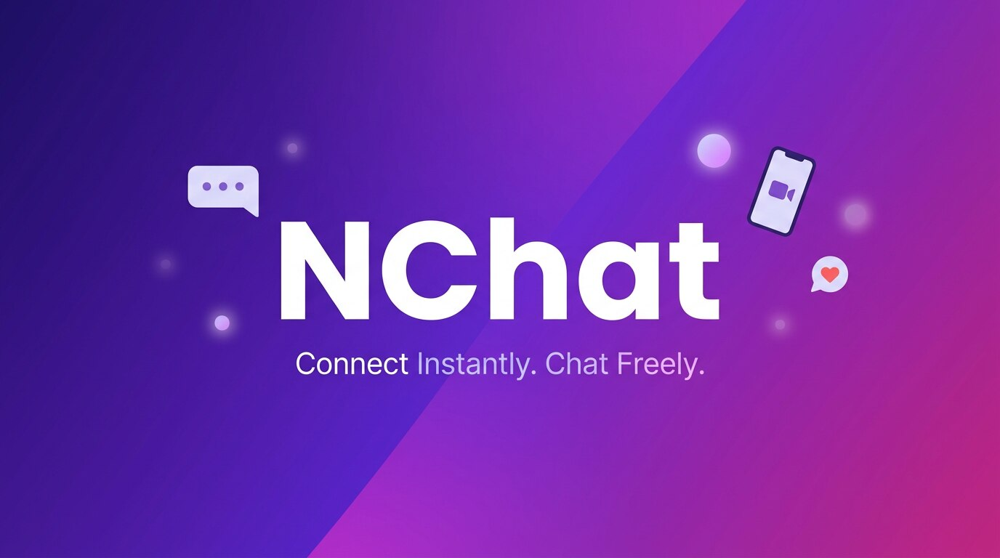

<div align="center">



# NChat

**A modern, real-time messaging app — your own alternative to WhatsApp, Messenger & WeChat.**

[](./LICENSE)
[](https://react.dev)
[](https://www.typescriptlang.org/)
[](https://workers.cloudflare.com/)
[](./android)
[](./CONTRIBUTING.md)

[Features](#-features) • [Tech Stack](#%EF%B8%8F-tech-stack) • [Getting Started](#-getting-started) • [Project Structure](#-project-structure) • [Contributing](#-contributing) • [License](#-license)

</div>

---

## 📖 About

**NChat** is a production-grade, real-time messaging app built from the
ground up as a fast, private, and fully self-hosted alternative to the
chat apps you already use. One-to-one and group messaging, voice & video
calls, disappearing messages, status/stories, friend discovery, and rich
media sharing — all running on a modern serverless stack with no
third-party backend lock-in.

A full, plain-language overview of what the app does for its users lives
in [`APP_DESCRIPTION.md`](./APP_DESCRIPTION.md) — the section below is the
developer-facing feature list.

## ✨ Features

| | |
|---|---|
| 💬 **Instant Messaging** | 1:1 and group chat, offline-first with optimistic sends and local queueing — messages never feel stuck |
| 😊 **React, Reply & Forward** | Emoji reactions, threaded replies with quoted previews, forwarding to any contact or group, edit & delete |
| 👥 **Group Chats** | Create groups, manage members, share media, and keep every conversation organized |
| 📞 **Voice & Video Calls** | WebRTC-powered 1:1 and group calls, plus full call history (incoming/outgoing/missed) |
| 📸 **Status & Stories** | Text, photo, and video updates with view tracking and story replies |
| 🤝 **Friends & Discover** | Friend requests, blocking, and discovery of new people to connect with |
| 🟢 **Presence & Receipts** | Online/last-seen status, typing indicators, and read receipts |
| ⏳ **Disappearing Messages** | Conversations that clean up after themselves |
| 🔔 **Push Notifications** | Real-time alerts for messages, calls, and friend requests, even when the app is closed |
| 🔒 **Privacy Controls** | Per-contact privacy settings and blocking, built in from day one |
| 📱 **Cross-Platform** | Responsive web app plus a native Android build via Capacitor |

## 🛠️ Tech Stack

NChat runs on a fully serverless, edge-native stack — no servers to
manage, generous free tier, and it scales globally by default.

| Layer | Technology |
|---|---|
| **Frontend** | React 19, TypeScript, Vite, Tailwind CSS, Radix UI (shadcn-style components) |
| **Mobile** | Capacitor (native Android wrapper around the same web app) |
| **Backend API** | Cloudflare Workers ([Hono](https://hono.dev)) |
| **Database** | Cloudflare D1 (SQLite at the edge) |
| **Realtime** | Cloudflare Durable Objects (WebSocket rooms) |
| **Media Storage** | Cloudflare R2 |
| **Calls** | WebRTC (peer-to-peer voice & video) |
| **Auth** | Custom JWT (access + refresh tokens), PBKDF2 password hashing |

Everything backend-related lives in [`worker/`](./worker) and deploys as a
single Cloudflare Worker.

## 🚀 Getting Started

### Prerequisites

- Node.js ≥ 18 and npm ≥ 9
- A free [Cloudflare](https://cloudflare.com) account (for the backend)

### 1. Clone & install

```bash
git clone https://github.com/<your-username>/nchat-friends.git
cd nchat-friends
npm install
```

### 2. Configure the frontend

```bash
cp .env.example .env.local   # point VITE_API_URL at your Worker (see below)
```

### 3. Deploy the backend

The API needs to be deployed to Cloudflare before the app is usable. Pick
whichever guide matches how you like to work:

- [`worker/SETUP_GUIDE.md`](./worker/SETUP_GUIDE.md) — CLI-based (`wrangler`), fastest if you have a terminal
- [`worker/DASHBOARD_SETUP_GUIDE.md`](./worker/DASHBOARD_SETUP_GUIDE.md) — 100% Cloudflare dashboard + GitHub web UI, no CLI/terminal required (works from a phone)

Once deployed, set `VITE_API_URL` in `.env.local` to your Worker's URL.

### 4. Run it

```bash
npm run dev      # http://localhost:3000
```

### Building for Android

A native Android build is already wired up via Capacitor — see
[`android/`](./android) and the `Build Android APK` GitHub Actions
workflow under **Actions → Build Android APK → Run workflow**.

## 📁 Project Structure

```
src/                   React app (components, hooks, services, utils)
  components/          UI screens (Chats, Groups, Calls, Status, Settings, Auth, ...)
  components/ui/       Radix-based design system primitives
  services/            One module per domain (chat, friends, groups, calls,
                        status, media, notifications, ...) — the only layer
                        allowed to talk to the backend
  hooks/               React hooks wrapping the services for components
  lib/                 apiClient.ts (REST) and realtimeClient.ts (WebSocket)
  types.ts             Shared TypeScript data contracts

worker/                Cloudflare Workers backend (the API)
  src/routes/          REST endpoints (auth, users, friends, messages,
                        groups, calls, status, media)
  src/durable-objects/ RealtimeRoom — WebSocket hub for live updates
  migrations/          D1 (SQLite) schema
  README.md            API reference + architecture notes

android/               Capacitor-generated native Android project
docs/assets/           Images used in this README
```

## 🧭 Roadmap / Status

Actively migrating off a legacy prototype backend onto the Cloudflare
stack above. Auth, user profiles, friends, messaging, groups, calls,
status, and media routes are live on the Worker API. A handful of
secondary services are still being wired up — see
[`worker/README.md`](./worker/README.md) for the exact checklist.

## 🤝 Contributing

Contributions, bug reports, and feature ideas are welcome! Please read
[`CONTRIBUTING.md`](./CONTRIBUTING.md) for setup instructions, coding
conventions, and the pull request process.

## 📄 License

This project is licensed under the [MIT License](./LICENSE).

---

<div align="center">

**Developed and maintained by [Muhammad Nasir](https://github.com/cybereagle472)**

If you like NChat, consider giving the repo a ⭐!

</div>
